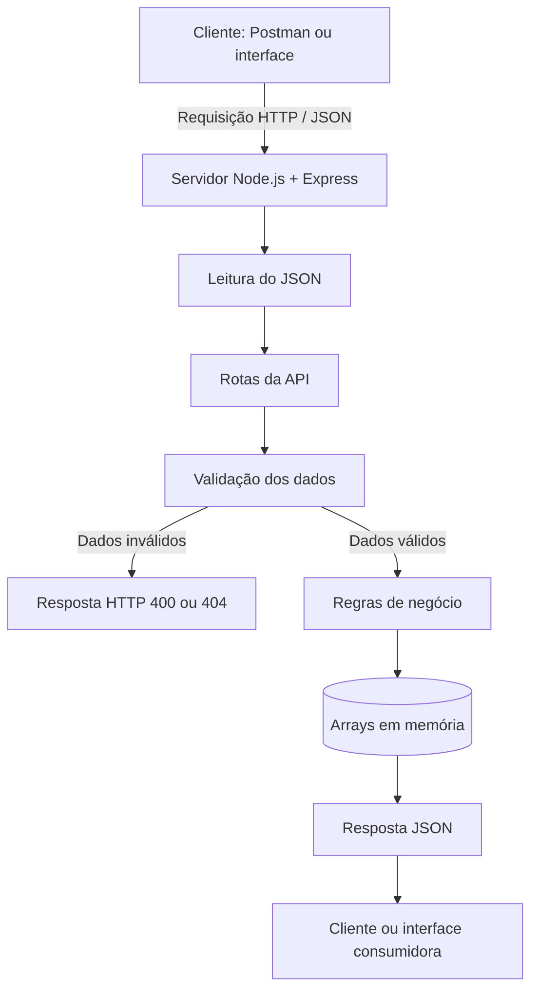

# Documentação da Arquitetura de Integração

## 1. Objetivo

Esta documentação apresenta como os dados da API de Gestão de Atividades Acadêmicas são recebidos, validados, armazenados e disponibilizados para outros sistemas ou interfaces.

## 2. Tecnologias utilizadas

- **Node.js:** ambiente de execução do JavaScript.
- **Express:** responsável pelas rotas HTTP e pelo funcionamento do servidor.
- **express.json():** interpreta o corpo das requisições que chegam em JSON.
- **JavaScript:** implementa as regras de negócio e as validações.
- **Armazenamento em memória:** arrays mantêm temporariamente as disciplinas e atividades.

## 3. Arquitetura e fluxo dos dados

O fluxo implementado nesta versão é:

1. Um cliente (por exemplo, Postman, navegador ou futura interface) envia uma requisição HTTP.
2. O Express recebe a requisição. O middleware `express.json()` interpreta os dados JSON.
3. A rota correspondente recebe os dados e executa as validações.
4. Se os dados forem válidos, a aplicação consulta ou altera os arrays `disciplinas` e `atividades`.
5. A API devolve uma resposta em JSON com os dados ou uma mensagem de erro e o código HTTP correspondente.
6. Uma interface ou outro consumidor pode utilizar essa resposta para apresentar as informações.



## 4. Organização dos dados

A aplicação trabalha com duas entidades:

- **Disciplina:** possui identificador, nome e professor.
- **Atividade:** possui identificador, título, descrição, data de entrega, status e o identificador da disciplina relacionada.

Uma disciplina pode possuir várias atividades. Cada atividade está associada a uma disciplina por meio de `disciplinaId`.

## 5. Rotas disponíveis para consumo

| Método | Rota | Finalidade |
|---|---|---|
| GET | `/api/health` | Verificar se a API está ativa |
| GET | `/api/disciplinas` | Consultar disciplinas |
| POST | `/api/disciplinas` | Cadastrar disciplina |
| GET | `/api/atividades` | Consultar atividades |
| GET | `/api/atividades/:id` | Consultar uma atividade |
| POST | `/api/atividades` | Cadastrar atividade |
| PATCH | `/api/atividades/:id/status` | Atualizar o status |
| DELETE | `/api/atividades/:id` | Excluir atividade |

As rotas retornam dados em JSON. Os principais códigos utilizados são 200 (operação realizada), 201 (cadastro realizado), 400 (requisição inválida) e 404 (registro ou rota não encontrado).

## 6. Controles de qualidade implementados

O código contém validações para evitar o processamento de informações incorretas:

- Verifica se nome, professor, título e descrição foram informados.
- Confere se o identificador é um número inteiro positivo.
- Valida o formato e a existência real da data de entrega.
- Verifica se a disciplina informada existe antes de cadastrar uma atividade.
- Aceita somente os status `pendente`, `em andamento` e `concluida`.
- Trata JSON malformado e rotas inexistentes.
- Retorna códigos HTTP e mensagens para indicar o resultado da operação.

## 7. Como demonstrar o funcionamento

Com o projeto instalado, execute:

```bash
npm install
npm start
```

O servidor utiliza a porta 3000 por padrão. Para verificar o funcionamento, faça as seguintes demonstrações no Postman ou ferramenta equivalente:

1. Envie `GET http://localhost:3000/api/health` e confira a resposta `{"status":"ok"}`.
2. Envie `GET http://localhost:3000/api/disciplinas` e confira a lista inicial.
3. Envie `GET http://localhost:3000/api/atividades` e confira a lista inicial.
4. Cadastre uma disciplina com `POST /api/disciplinas`, enviando JSON com `nome` e `professor`.
5. Cadastre uma atividade com `POST /api/atividades`, informando `titulo`, `descricao`, `dataEntrega` no formato AAAA-MM-DD e `disciplinaId) existente.
6. Consulte a atividade e atualize seu status com `PATCH /api/atividades/1/status`, usando um status permitido.
7. Faça uma requisição com dados inválidos para demonstrar a resposta de validação.

**Evidências para anexar à entrega:** capturas de tela do servidor iniciado, da rota de saúde, de uma consulta, de um cadastro bem-sucedido e de uma validação de dados inválidos. As capturas devem ser feitas após executar os testes; não são substituídas por exemplos escritos nesta documentação.

## 8. Limitações e melhorias futuras

Nesta versão, os dados ficam somente em memória. Portanto, são perdidos quando o servidor é reiniciado. O repositório também não contém uma interface conectada à API nem um banco de dados configurado.

Como evolução, recomenda-se integrar um banco de dados, implementar persistência, configurar variáveis de ambiente e conectar uma interface consumidora. Assim, os dados poderão ser mantidos entre execuções e utilizados por uma aplicação completa.

## 9. Conclusão

A API já disponibiliza uma camada de integração por meio de rotas REST e respostas JSON. O fluxo de recebimento, validação, processamento e disponibilização dos dados está implementado para disciplinas e atividades. A documentação registra o funcionamento atual e deixa claras as etapas que ainda podem ser evoluídas.
